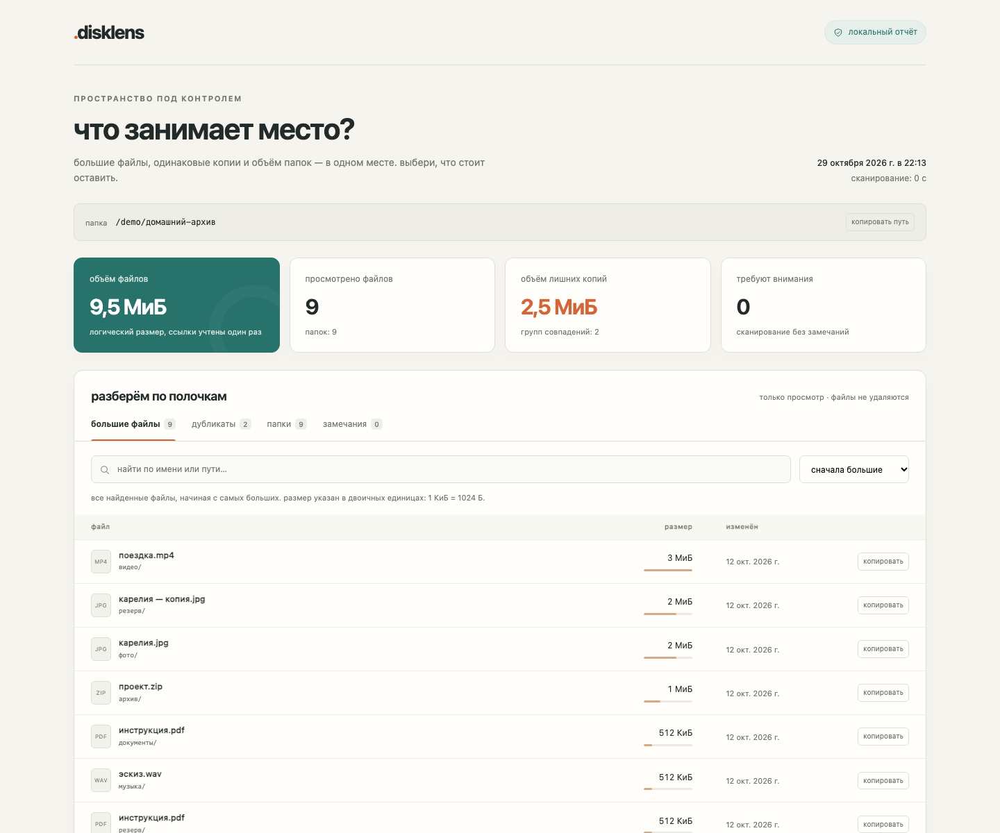

# .disklens

локальный анализатор диска: крупные файлы, тяжёлые папки и точные дубликаты в одном HTML-отчёте.

помогает разобрать загрузки, архив фотографий или внешний накопитель. отчёт открывается обычным файлом: поиск, сортировка, группы одинаковых копий и копирование полного пути. сервер, аккаунт и подключение к интернету не нужны.

работает на Python 3.11+ в Linux, macOS и Windows. сторонних зависимостей во время работы нет. исходные файлы не изменяет.



## запуск

```sh
git clone https://github.com/dayanegosha/disklens.git
cd disklens
python3 -m venv .venv
source .venv/bin/activate
pip install .
disklens ~/Downloads --open
```

в Windows создание окружения — `py -3 -m venv .venv`, активация — `.venv\Scripts\Activate.ps1`. остальные команды те же.

по умолчанию создаётся `disklens-report.html` в текущей папке. его можно открыть двойным кликом, перенести на другое устройство или дополнительно сохранить JSON. существующий отчёт перезаписывается только с `--force`.

## примеры

```sh
# выбрать выходные файлы
disklens ~/Downloads --html downloads.html --json downloads.json

# не обходить служебные папки и временные файлы
disklens ~/Projects --exclude .git --exclude node_modules --exclude '*.tmp'

# искать копии только от 10 МиБ, сохранив полный список файлов
disklens ~/Pictures --min-size 10MiB --open

# быстрый обзор размеров без чтения содержимого
disklens /Volumes/Archive --no-duplicates --open

# сводка только в терминале
disklens . --no-html

# повторить анализ и обновить отчёт
disklens ~/Downloads --force --open
```

`--exclude` принимает glob-шаблон имени или относительного пути; совпавшие папки пропускаются целиком. `.gitignore` автоматически не применяется. `--min-size` влияет только на поиск дубликатов: `1MiB` — 1 048 576 байт, `1MB` — 1 000 000 байт. `--quiet` скрывает сводку и прогресс, но сохраняет сообщения об ошибках.

## как считается

сначала файлы группируются по размеру, затем сравниваются начало и конец. полное совпадение подтверждается SHA-256 всего содержимого. файлы уникального размера читать не требуется; содержимое больших файлов обрабатывается блоками.

символические ссылки и точки повторного анализа Windows не обходятся. жёсткие ссылки на один файл считаются один раз, их дополнительные пути видны в отчёте. пустые файлы не образуют группы дубликатов.

размеры логические: сжатие, разреженные файлы и клоны файловой системы могут менять фактически занятое место. объём повторяющихся данных рассчитан при сохранении одной копии из каждой группы и не гарантирует столько же свободного места после ручной очистки. размер папки включает подпапки, поэтому строки папок нельзя складывать.

отчёт отражает состояние во время обхода, а не атомарный снимок диска. файлы, изменившиеся при проверке, исключаются из подтверждённых совпадений. ошибки доступа и изменения перечислены в разделе «замечания». на живом архиве лучше остановить запись и повторить сканирование перед очисткой.

выбранные выходные HTML и JSON исключаются из анализа. файл отчёта содержит полный корневой путь и имена файлов; перед публикацией проверь его содержимое. исходные данные никуда не отправляются.

## демо и проверка

в [`examples/`](examples/) лежит готовый отчёт на искусственных файлах и скрипт, который его пересоздаёт:

```sh
python examples/demo.py
python -m unittest discover -s tests -v
```

JSON содержит версию схемы, сводку, файлы, размеры папок, группы дубликатов, жёсткие ссылки, замечания и параметры поиска. размеры указаны в байтах, даты — в UTC.

код завершения: `0` — анализ закончен, включая возможные замечания; `1` — не удалось начать анализ или сохранить отчёт; `2` — неверные аргументы; `130` — прерывание с клавиатуры.

## лицензия

[MIT](LICENSE)
